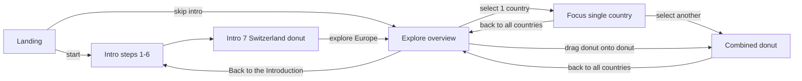
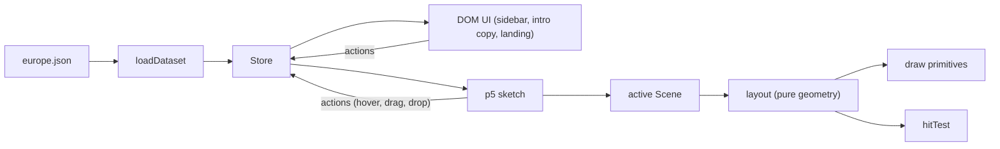

# HOW EUROPE WORKS – Web App Specification

Status: draft v0.2 (2026-10-22)
Author: Jakob Reichelt (concept, design) · implementation plan drafted with AI assistance

This document describes **what** the web app is and **how** it is built. It is the single source of truth for humans and AI agents working on the project. When the code and this spec disagree, either fix the code or update the spec in the same change.

---

## 1. Purpose

HOW EUROPE WORKS is an exploratory interface about the world of work in European cities. It turns the Eurostat Urban Audit dataset into an interactive canvas of donut diagrams. Each diagram is one country, and each segment of it is one city. The visual grammar shows how many people work there, which economic sector dominates, how many people commute in, how men and women are balanced, how high unemployment is and how long the way to work takes.

The web app builds the Figma prototype from module Think 3 (HSLU, BA Data Design + Art, 15.09.–09.10.2026) as a working application. The process documentation ends with the goal this app delivers: UI animations, a working canvas and diagrams you can move.

### Goals
- A faithful version of the Figma prototype in the browser, driven by real data instead of placeholder numbers.
- A smooth, animated feel: an onboarding story, a canvas you can pan and drag, and a transition from bar to donut.
- A clean, documented codebase that AI agents can understand and extend safely.

### Non-goals (for v1)
- A mobile or touch-first layout. The app targets desktop and laptop, designed at 1536 × 960, with a minimum of 1280 × 720.
- Time series. The dataset is treated as one snapshot, and the copy says "2025".
- A backend. The app is fully static and can be deployed to any static host.

---

## 2. Sources

| Source | Location | Used for |
|---|---|---|
| Figma prototype | `figma.com/design/YyCrxpHa9VACRwwsFevHWm` | layout, components, colours, type, motion |
| Screencast | `assets/26HS_DDA25_Think3_Reichelt_Jakob_Screencast.mp4` | interaction behaviour, flow |
| Dataset | `assets/eurostat_european_cities.csv` | all numbers |
| Font | `assets/Baikal-VAR-VF.ttf` | all typography |
| Process documentation | `assets/2026-10_Think3_Prozessdokumentation.pdf` | concept, intent |

### Figma frames

| Node ID | Name / content | Implemented in |
|---|---|---|
| `393:13621` | Landing (title, start, skip intro, rotating background) | `LandingScene`, `ui/Landing` |
| `415:1295` | Intro 1 – working people | `IntroScene` step 1 |
| `415:2517` | Intro 2 – commuter rate | step 2 |
| `417:2603` | Intro 3 – gender ratio | step 3 |
| `419:2683` | Intro 4 – unemployment rate | step 4 |
| `419:2712` | Intro 5 – average time to work | step 5 |
| `419:2744` | Intro 6 – everything combined | step 6 |
| `419:2812` | Intro 7 – Switzerland donut, "explore Europe!" | step 7 |
| `347:6230` | Explore – info panel open | `ExploreScene`, `ui/InfoPanel` |
| `288:10567` | Explore – interaction panel open | `ui/Sidebar` |
| `393:8528` | Explore – sector filter active | `ui/SectorFilter` |
| `360:5355` | Explore – legend overlay | `ui/LegendToggle`, legend overlay drawing |
| `360:2397` | Selection – combined countries (France + Spain) | combined donut |
| `230:10924` | Selection – single country (France) | focus mode |
| `332:836` | Component sheet (sidebar parts, sector swatches) | `ui/*`, `theme.ts` |
| `236:5438` | City segment default vs. hover | hover state |
| `393:16582` | Country donut default vs. hover | hover state |

---

## 3. User journey



### 3.1 Landing
- The title "HOW EUROPE WORKS" is in Baikal Bold 38/32 with letter spacing -0.76. "HOW" is `#cce3de`, "EUROPE" is `#4da1a9` and "WORKS" is `#ffa630`.
- The subtitle reads "aspects of work in European cities".
- There are two links: **start →** (black) and **skip intro →** (50% opacity).
- Background: two large donut fragments at 35% opacity rotate slowly. The values come from the Figma motion data:
  - Land 1 rotates from 0.524 rad to -1.745 rad.
  - Land 2 rotates from -1.439 rad to 4.844 rad.
  - Both run for 20.016 s, back and forth, infinitely, eased with `cubic-bezier(0.5, 0, 0.5, 1)`.

### 3.2 Intro – the Zurich story
A narrow left strip (24 px, vertical "HOW EUROPE WORKS" in Bold 15, mode label "Intro" in italic grey `#a9a9a9`) stays visible. The content column is about 364 px wide and centred. Each step has a short text and a chart, with **← back** and **next →** below.

A single horizontal bar stands for one city, Zurich. Each step adds one visual channel, and the change is animated:

| Step | Text (template) | Chart change |
|---|---|---|
| 1 | "This is **Zurich**. One of many European cities. In 2025, Zurich had" | empty box with a range bracket and the label "**{workingPeople}** working people" |
| 2 | "the rate of people **commuting** to Zurich in 2025 was" | hatched portion = commuter rate, with a bracket and "{commuterRate}%" |
| 3 | "The people working in Zurich were to" | dotted vertical divider at the male share, "♂ {maleShare}% male" |
| 4 | "The unemployment rate in Zurich was" | grey band above the box. Its thickness is the unemployment bucket, with guide lines for high / medium / low |
| 5 | "The average time to work in Zurich was" | three red guide lines appear: solid 30 min, dashed 40 min, dotted 50 min. The box moves up or down until its base sits at Zurich's commute time (39.9 min, on the 40 min line). The nearest guide label is shown in black, the others in grey |
| 6 | "In 2025, Zurich looked like this:" | all channels combined |
| 7 | "Together with the next two largest Swiss cities, this is what Zurich looks like:" | the bar bends into an arc and joins Geneva and Basel to form the Switzerland donut. Button: "explore Europe! →" |

Every number in the copy comes from the data (see §5). The Figma placeholders (408'703, 30%, 60%) are replaced. Numbers use Swiss formatting with an apostrophe (`408'783`).

### 3.3 Explore – the canvas
- One donut per country (18 countries) is scattered on a 2D world canvas larger than the screen.
- The outer donut radius scales with the square root of the country's total working people, clamped to a minimum and maximum. France and Germany are large, and Luxembourg is small.
- Pan the canvas by dragging the background. Zoom with the mouse wheel, clamped (optional in v1).
- Hovering a country darkens its shadow band (`393:16582`).
- Hovering a city segment darkens that segment's shadow and shows curved text along the arc (`236:5438`): "**{City}** has {workingPeople} working people", plus "commuter-rate of {x}%" at the hatch boundary.
- Drag and drop: drag a country donut and drop it onto another one. Both become the selection and the combined view opens (see §3.6).

### 3.4 Sidebar – vertical accordion
The left side has two parts:
- A **24 px strip**: the vertical "HOW EUROPE WORKS" plus the mode label ("overview mode", "Intro").
- A **127 px panel**.

The panel switches between two states:

- **Info panel** (`347:6230`): a big stacked "HOW / EUROPE / WORKS" and three accordion items:
  - "Back to the Introduction"
  - "About this Project" (expands to text)
  - "About the Data" (expands to text)

  At the top is a small vertical tab "↓ Interaction" that switches to the interaction panel.
- **Interaction panel** (`288:10567`), from top to bottom:
  - The "Interaction" tab. In focus or combined mode it becomes "back to all countries ↑".
  - **Legend** toggle. When active, the button shows a ring dot on its right edge.
  - **Biggest Economic Sectors**: an italic header with a multicolour dot that means "all sectors". Below it the four sector entries: public services, trade and hospitality, business services, industry.
  - **Countries**: an italic header, a search field (grey `#eee`, magnifier icon) and an alphabetical country list. Selected countries move to the top in medium weight, each with a black dot on the panel edge, separated from the rest by a rule.

Hovering an accordion item shows a thin `#dadedc` (multiply) hover bar.

### 3.5 Sector filter
Hovering a sector previews the filter; clicking pins it. While a filter is active:
- Every segment whose biggest sector is a different one is drawn white. Outlines, hatching and the gender tick stay.
- The sidebar shows the active sector in bold with its colour dot.

Clicking the "Biggest Economic Sectors" header resets the filter to "all".

### 3.6 Selection: focus and combine
- **0 selected**: the overview (all donuts).
- **1 selected** (`230:10924`): the camera animates to centre that country at its focus size, and the other donuts fade out.
- **2 or more selected** (`360:2397`): the cities of all selected countries merge into one donut, sorted by country and then by working people. A thin outer ring with bracket ticks and uppercase labels (FRANCE, SPAIN) marks which arc belongs to which country. The centre label is left out, or shows "{n} countries".
- **"back to all countries ↑"** clears the selection and animates back to the overview.

### 3.7 Legend overlay (`360:5355`)
While the legend is on, all donuts fade to about 15% opacity except one reference donut, either the focused one or the one nearest the centre. The overlay draws callouts with leader lines:
- high / medium / low guides at the shadow band
- "unemployment is low" (or medium / high, from the data)
- "% of commuters" at the hatch
- "gender ratio" at the tick
- "50 min way to work" / "40 min" / "30 min" next to the three red guide rings. They show how far a segment has moved outward because of its commute time
- "drag and drop to compare countries" with a long curved arrow

---

## 4. Visual grammar

### 4.1 Donut anatomy (one country)

| Element | Figma layer | Encodes | Rule |
|---|---|---|---|
| City segment (filled ring band) | `Base` | share of the country's working people | arc angle = `city.workingPeople / country.workingPeople × (360° − gaps)` |
| Segment fill colour | `Base` fill | biggest economic sector | sector colour (§4.2) |
| Radial position of the segment | `Base` position | average time to work | the segment moves outward from the baseline. Its inner edge sits at `r(commuteMinutes)`, so a longer commute means a segment further out. The shadow band, hatch, tick and label move with it |
| Hatched part of the segment | `Streifen` | commuter rate | hatched arc angle = `commuterRate × segment angle`, starting at the segment start. 45° diagonal lines, 1 px black |
| Grey band outside the segment | `Schatten` | unemployment level | band thickness: low = 1 step, medium = 2 steps, high = 3 steps |
| Radial tick with ♀ / ♂ and "%" | `Gender` | gender ratio | tick at the angle where the male share ends inside the segment. The label shows the larger share with its symbol |
| Red guide rings | inner rings | scale for the commute time | always drawn as full circles at `r(30)` solid, `r(40)` dashed and `r(50)` dotted. They encode nothing themselves. They only show how far each segment has moved |
| Outer, middle and inner thin rings | `Außen`, `Mittel`, `Innen` | structure only | concentric outlines |
| Centre label | text | country name | Baikal 18/20 |
| City label | curved text | city name | Baikal 14, along the outer edge at the segment start |

Segments are separated by a small angular gap. The different radial positions come from the data, not from decoration: they are the "exploded" look from the sketches.

**Commute scale.** The scale `r(minutes) = baseline + (minutes − minMinutes) × pxPerMinute` is linear and the same for every donut on screen, so offsets can be compared between countries. It scales together with the donut size.
- The baseline is the innermost ring (`Innen`), i.e. the shortest commute in the domain.
- The domain is clamped, e.g. 20–55 min, so outliers don't explode the layout.
- `baseline`, `minMinutes` and `pxPerMinute` live in `theme.ts`.

Commute time is continuous: a 33 min commute sits between the 30 and 40 min guides. The ring radii are proportions of the outer radius R. The selection frame measures roughly R, 0.88 R and 0.76 R. Exact values are measured from the Figma frames during implementation.

### 4.2 Colours

| Token | Hex | Use |
|---|---|---|
| `sector.public` | `#cce3de` | public services (NACE O–Q) |
| `sector.trade` | `#4da1a9` | trade and hospitality (NACE G–I) |
| `sector.business` | `#ffa630` | business services (NACE M + N) |
| `sector.industry` | `#e8e6bd` (to verify in Figma) | industry (NACE B–E) |
| `ink` | `#000000` | outlines, text |
| `paper` | `#ffffff` | background, filtered-out segments |
| `shadow` | `#dadedc` | unemployment band, hover bars |
| `shadow.hover` | `#b5bbb8` (to verify) | hovered shadow |
| `muted` | `#a9a9a9` / `#808080` | secondary labels |
| `field` | `#eeeeee` | search input |
| `commute` | red (to verify) | the three commute guide rings (30 / 40 / 50 min) |

### 4.3 Typography
The font family is **Baikal VAR** (variable font, `assets/Baikal-VAR-VF.ttf`).

| Style | Size / line height | Use |
|---|---|---|
| xs | 14 / 16 regular | body, sidebar, labels |
| xs italic | 14 / 16 italic | sidebar headers ("Countries", "Biggest Economic Sectors") |
| xs medium | 14 / 16 medium | selected countries |
| s | 18 / 20 regular | arrows, country centre label |
| strip | 15 / 16 bold | vertical "HOW EUROPE WORKS" |
| title | 38 / 32 bold, -0.76 tracking | landing title |

If the variable font has no italic axis, the browser fakes the italic with `font-synthesis`.

### 4.4 Motion
- Easing defaults to `cubic-bezier(0.5, 0, 0.5, 1)`, matching Figma. Durations: hover 150 ms, intro steps 600 ms, camera moves 800 ms, combining donuts 900 ms.
- Intro transitions animate the new channel only. For example, the hatch grows from 0 to its value. In step 5 the box slides to its commute position while the guide lines stay put.
- Segments always move radially when their position changes, e.g. when donuts combine or the data reloads. The red guides never move relative to their donut.
- From intro step 6 to 7 the bar bends into an arc. The same segment geometry is drawn with a blend factor between straight (0) and curved (1).
- Combining countries: the segments of the source donuts fly to their new angles in the combined donut.
- Respect `prefers-reduced-motion`: jump to the end states.

---

## 5. Data

### 5.1 Source
- The file `eurostat_european_cities.csv` has 49 cities and about 180 indicator columns, and one row per city.
- Column prefixes:
  - `cenv_`: environment
  - `clivcon_`: living conditions
  - `clma_`: labour market
  - `cpop*`: population
  - `ctour_`: culture and tourism
  - `ctran_`: transport
- Empty strings mean *missing*. They are never treated as zero.

### 5.2 City → country mapping
The CSV has no country column, so `data/config/cities.json` maps each CSV `cities` value to:
- `id` (slug)
- `name` (display name, e.g. "Zurich" for "Zurich (greater city)")
- `country` (ISO 3166 alpha-2, with `UK` for the United Kingdom as used by Eurostat)

The build fails if a CSV city is not mapped.

The 18 countries in the data are AT, BE, CH, CZ, DE, ES, FR, HR, HU, IE, IT, LU, NL, PL, PT, SI, SK and UK. They match the Figma country list.

### 5.3 Derived metrics (per city)

| Metric | Formula / source column | Notes |
|---|---|---|
| `workingPeople` | `clma_Economically active population, 20-64, total` | falls back to `clma_Persons employed, 20-64, total` |
| `commuterRate` | `ctran_People commuting into the city` ÷ workplace jobs | published jobs total, or the NACE A-T sum when that sum is more than 1.5 times the total. A ratio above 1 is missing |
| `maleShare` | `clma_Economically active population, 20-64, male` ÷ `…20-64, total` | female share = 1 − male share |
| `unemploymentRate` | `clma_Unemployment rate` (%) | bucketed into low / medium / high |
| `commuteMinutes` | `ctran_Average time of journey to work - minutes` | continuous. Sets the segment's radial offset (§4.1) |
| `sectors.public` | `clma_Employment (jobs) in public administration, … (NACE Rev. 2, O to Q)` | |
| `sectors.trade` | `clma_Employment (jobs) in trade, transport, hotels, restaurants (NACE Rev. 2, G to I)` | |
| `sectors.business` | `… professional, scientific and technical …; administrative and support … (M and N)` | |
| `sectors.industry` | `clma_Employment (jobs) in mining, manufacturing, energy (NACE Rev. 2, B-E)` | |
| `biggestSector` | the largest of the four sector values | `null` if all four are missing |

All column names live in one `METRICS` map in `scripts/lib/buildDataset.ts`. Changing which indicator feeds a channel is a one-line change.

**Buckets and scales.** These are first proposals and can be changed in `src/config/encoding.ts`:
- Unemployment: low < 7%, medium 7–12%, high ≥ 12%.
- Commute is not bucketed. `encoding.ts` holds the commute scale domain (e.g. 20–55 min) and the guide values `[30, 40, 50]`.

**Per-country aggregates:**
- `workingPeople`: the sum over the country's cities
- `cities`: sorted descending by working people
- `share`: each city's share of the country total

### 5.4 Reference values: Switzerland, as used in the intro

| City | workingPeople | commuterRate | maleShare | unemployment | commute | biggest sector |
|---|---|---|---|---|---|---|
| Zurich | 408'783 | 32% | 53% | 6.15% (low) | 39.9 min | public services |
| Geneva | 192'367 | 14% | 51% | 13.21% (high) | 36.1 min | public services |
| Basel | 171'556 | 17% | 51% | 6.21% (low) | 33.1 min | public services |

In the Switzerland donut, Zurich sits furthest out (just below the 40 min guide), Geneva in between and Basel closest to the 30 min guide.

These values double as test fixtures for the build script.

### 5.5 Known differences from the Figma prototype
- Figma shows **Bern** in Switzerland and **Faro** in Portugal. Neither is in the dataset. The app uses the real cities: Switzerland is Zurich, Geneva and Basel, and Portugal is Lisboa and Porto.
- The Figma numbers (408'703 working people, 30% commuters, 60% male, "Paris has 5'172'658 working People") are placeholders. The app shows real values.
- In the real data all three Swiss cities share the same biggest sector, so the Switzerland donut is less colourful than the mock-up.
- The Figma selection list includes countries that are not in the data (Bulgaria, Cyprus, Denmark, …). The app only lists countries that have data.
- Some cities have big gaps. Luxembourg is nearly empty, and Glasgow and Graz have no commute data. These cases get an explicit no-data style (§5.6).

### 5.6 Missing data rules
- No `workingPeople`: the city is left out of the donut. The country still lists it in the "About the Data" panel.
- No `commuterRate`: no hatch.
- No `maleShare`: no gender tick.
- No `unemploymentRate`: a dashed thin outline instead of the grey band.
- No `commuteMinutes`: the segment sits on the baseline (no offset) and its inner edge is drawn dashed to mark the missing value. The red guide rings are still drawn.
- No `biggestSector`: the segment is drawn with a white fill and a grey outline.
- The build script prints a coverage table (city × metric) and writes a `missing: string[]` list per city into the JSON.

### 5.7 Output schema (`public/data/europe.json`)

```ts
type SectorKey = 'public' | 'trade' | 'business' | 'industry';
type Bucket3 = 'low' | 'medium' | 'high';

interface City {
  id: string;            // "zurich"
  name: string;          // "Zurich"
  country: string;       // "CH"
  workingPeople: number | null;
  commuterRate: number | null;      // 0–1
  maleShare: number | null;         // 0–1
  unemploymentRate: number | null;  // percent
  unemploymentLevel: Bucket3 | null;
  commuteMinutes: number | null;    // continuous, drives the radial offset
  sectors: Record<SectorKey, number | null>;
  biggestSector: SectorKey | null;
  missing: string[];
}

interface Country {
  id: string;            // "CH"
  name: string;          // "Switzerland"
  workingPeople: number;
  cityIds: string[];     // sorted desc by workingPeople
}

interface Dataset {
  schemaVersion: 1;
  generatedAt: string;
  source: string;
  countries: Country[];
  cities: City[];
}
```

The app imports these types from `src/data/types.ts`. The build script imports the same file.

---

## 6. Technical architecture

### 6.1 Stack
- **Vite** with **TypeScript** in strict mode.
- **p5.js** in *instance mode* only, with `@types/p5`.
- **No UI framework.** The DOM UI is small, typed vanilla TS modules.
- **Build script:** `tsx` + `papaparse`.
- **Quality:** Vitest, ESLint and Prettier.
- **Deploy:** a static build in `dist/` (GitHub Pages, Netlify or the HSLU server).

### 6.2 Runtime overview



**Rules**
1. **Single source of truth.** All app state lives in one store. The DOM UI and the canvas both subscribe to it and only change it through actions. They never call each other directly.
2. **Split between DOM and canvas.**
   - HTML/CSS handles everything that is text-heavy or a control: the sidebar, intro copy, buttons, search and info texts. That keeps text crisp and gives focus handling, keyboard support and screen-reader support.
   - p5 draws the charts and the labels attached to them: curved city labels, hover arc text and legend callouts.
3. **Scenes.** The canvas has exactly one active scene:
   - `LandingScene`
   - `IntroScene`
   - `ExploreScene` (overview, focus and combined are modes of this scene)

   Interface: `draw(ctx)`, plus optional `pointerDown / pointerMove / pointerUp / wheel` handlers.
4. **Layout is separate from drawing.** `layout/donutLayout.ts` is a pure function `(cities, options) → DonutGeometry`, with angles, radii and styles per segment. `draw/*` only renders the geometry. `hit/hitTest.ts` uses the same geometry with polar maths, so layout and hit testing can be unit-tested without a browser.
5. **Camera.** The explore canvas works in world coordinates. The camera owns the pan offset, the zoom and `screenToWorld` / `worldToScreen`. Animated `focusOn(target, duration)` comes with the animation milestone.
6. **On-demand rendering.** The sketch calls `noLoop()` and redraws on store changes and pointer input. Once animations exist it loops only while a tween, drag or the landing rotation is running.
7. **Hatching and clipping.** Hatches are drawn inside an arc-shaped clip path, using `drawingContext.save() / clip() / restore()`.
8. **Text on canvas.** Use `textFont('Baikal VAR')` after `document.fonts.ready`. The CSS `@font-face` loads the font once, and DOM and canvas share it.
9. **Pixel density.** Use `pixelDensity(window.devicePixelRatio)`, capped at 2. The canvas resizes on window resize, and the camera keeps the world centre.
10. **Input.** The sketch listens to pointer events on its own canvas element, not to p5's global mouse callbacks, so clicks on the DOM sidebar never reach the canvas.

### 6.3 State

```ts
interface AppState {
  scene: 'landing' | 'intro' | 'explore';
  introStep: number;                       // 1–7
  sidebarPanel: 'interaction' | 'info';
  infoOpen: 'project' | 'data' | null;
  legendOpen: boolean;
  sectorFilter: SectorKey | null;          // null = all
  selection: string[];                     // country ids
  countrySearch: string;
  hover: { countryId: string | null; cityId: string | null };
}
```

**Routing.** The URL hash mirrors the persistent part of the state, for example `#/`, `#/intro/3` and `#/explore?sel=FR,ES&sector=trade&legend=1`. Reloading or sharing a link restores that view, and tests and AI agents can jump straight to any state.

### 6.4 Folder structure

```
/
  AGENTS.md                 short guide for AI agents (commands, rules, map of the repo)
  README.md
  docs/
    SPEC.md                 this document
    architecture.md         deeper notes on scenes, store, camera
    data-dictionary.md      metric descriptions and coverage notes
    figma-map.md            Figma node ID → module (kept in sync with §2)
  .cursor/rules/            scoped rules for canvas/, data/, ui/
  assets/                   original course material (read-only)
  data/
    raw/eurostat_european_cities.csv
    config/cities.json
  scripts/
    build-data.ts           file IO + coverage report
    lib/buildDataset.ts     pure CSV → Dataset transformation (tested)
  public/
    data/europe.json        generated, committed
    fonts/Baikal-VAR-VF.ttf
  src/
    main.ts
    config/   theme.ts, encoding.ts
    data/     types.ts, loadDataset.ts, selectors.ts, format.ts
    state/    types.ts, store.ts, actions.ts, router.ts
    canvas/
      sketch.ts, camera.ts
      scenes/   Scene.ts, LandingScene.ts, IntroScene.ts, ExploreScene.ts
      layout/   donutLayout.ts, barLayout.ts, worldLayout.ts
      draw/     shapes.ts, donut.ts, bar.ts
      hit/      hitTest.ts
    ui/       dom.ts, Landing.ts, IntroControls.ts, Sidebar.ts, InfoPanel.ts,
              InteractionPanel.ts, SectorFilter.ts, CountryList.ts
    content/  intro.ts, about.ts
    styles/   tokens.css, base.css, sidebar.css
    debug/    devApi.ts
  tests/
```

### 6.5 Commands

| Command | Does |
|---|---|
| `npm run dev` | Vite dev server |
| `npm run data` | rebuild `public/data/europe.json` from the CSV |
| `npm run test` | Vitest (build script, layout, hit test, selectors, router) |
| `npm run check` | `tsc --noEmit` + ESLint + Prettier check + tests: the single "is it green?" command |
| `npm run build` | production build to `dist/` |

---

## 7. AI-friendliness

The project should be easy for AI coding agents (and new humans) to navigate and change safely:

- **`AGENTS.md`** at the root, under 100 lines. It covers the purpose, the commands, the folder map, the golden rules and "how to add a metric / scene / UI panel".
- **Golden rules**, enforced through review and lint where possible:
  - p5 is used in instance mode only, with no globals.
  - Colours, sizes and fonts come only from `config/theme.ts` (TS) or `styles/tokens.css` (CSS). The two are kept in sync.
  - Data is accessed only through `data/selectors.ts`.
  - `canvas/` never touches the DOM outside its canvas element, and `ui/` never draws on the canvas. ESLint blocks imports between the two.
  - State changes go through `state/actions.ts` only.
  - Layout functions are pure and have tests.
- **One shared type file** (`src/data/types.ts`) for the build script and the app, so schema changes fail loudly.
- **Small files.** Each file has one responsibility and a short header comment that names its Figma node ID where relevant.
- **`docs/figma-map.md`** lets an agent fetch the matching frame with the Figma tools before changing a view.
- **Dev API.** In dev builds, `window.__HEW__ = { getState, actions, dataset }` lets browser-automation agents inspect and drive the app.
- **Stable `data-testid` attributes** on all interactive DOM elements.
- **Deterministic layout.** The world layout uses fixed seeds, so screenshots are reproducible.

---

## 8. Accessibility basics
- All controls are real `<button>`, `<a>` and `<input>` elements with visible focus styles.
- The accordion uses `aria-expanded` and `aria-controls`.
- The canvas has `role="img"` and a live `aria-label` that summarises the current view, e.g. "France: 3 cities, 6.2 million working people".
- Keyboard: arrow keys pan the canvas, `+` / `-` zoom, `Esc` clears the selection or closes the legend, and Enter on a country selects it.
- `prefers-reduced-motion` is respected (§4.4).

---

## 9. Milestones

1. **Setup.** Install Node LTS, `git init` in the project folder, scaffold Vite + TS, set up tooling, write `AGENTS.md` and the docs.
2. **Data.** Write `cities.json` and `build-data.ts`, generate `europe.json`, add the coverage report and tests (with the Swiss reference values).
3. **Core.** Theme and encoding config, store, actions and router, font loading, the p5 sketch with the scene manager, the camera and the render loop.
4. **Donut.** Layout, draw primitives and hit test. Verify visually against `230:10924`, `236:5438` and `393:16582`.
5. **Landing.** Rotating fragments plus the DOM title and links.
6. **Intro.** The seven steps, the bar layout, the animated channels and the bend into the Switzerland donut.
7. **Explore.** World layout, pan and zoom, hover states and arc text, drag-and-drop combine.
8. **Sidebar.** Info panel, legend overlay, sector filter, country list with search and selection, the combined donut with country brackets.
9. **Polish.** Missing-data styles, resize handling, accessibility pass, dev API, frame-by-frame comparison with Figma, deploy.

Milestones 1–3 are done as a wireframe base. Milestones 4–8 exist as static wireframes: geometry, data and interaction are wired up, but there is no final styling and no animation yet.

---

## 10. Open questions and decisions

| # | Topic | Proposal | Status |
|---|---|---|---|
| 1 | Indicator for "working people" | economically active population 20–64 (matches the order of magnitude of the Zurich intro) | proposed |
| 2 | Unemployment thresholds | low < 7%, medium 7–12%, high ≥ 12% | proposed |
| 3 | Commute scale | linear radial offset from the baseline, domain about 20–55 min, guides at 30 / 40 / 50, shared by all donuts. Final px-per-minute measured from Figma | proposed |
| 4 | Industry colour hex | sample from the Figma swatch on `332:836` | to verify |
| 5 | Placement of donuts on the canvas | seeded near each country's geographic centre, then collision relaxation, editable in `worldLayout.ts` | proposed |
| 6 | Countries with a single city (LU) | single full-ring segment, no gaps | proposed |
| 7 | Gender tick label | show the larger share with its symbol (♂ 53%) | proposed |
| 8 | Zoom on the explore canvas | optional in v1, clamped 0.3×–2× | proposed |
| 9 | Copy language | English, as in Figma | decided |
| 10 | Stack | Vite + TypeScript + p5 (instance mode), DOM UI without a framework | decided |
| 11 | Data pipeline | Node build script → committed JSON | decided |
