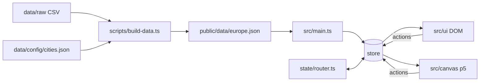

# Architecture

## Layers



- **Data pipeline (build time).** `scripts/lib/buildDataset.ts` is a pure function from CSV text
  - config to a `Dataset`. `scripts/build-data.ts` does the file IO. The app never parses CSV.
- **Store.** `createStore` holds one `AppState` object (`src/state/types.ts`). `setState` merges
  shallowly and notifies subscribers only if something changed. All changes go through
  `createActions` (`src/state/actions.ts`).
- **Router.** `connectRouter` keeps `location.hash` and the store in sync, both ways. Scene,
  intro step, selection, sector filter and legend are in the URL; hover and sidebar are not.
- **UI (DOM).** `mountUi` builds each component once (`{ el, update(state, previous) }`) and calls
  `update` on every change. Text, buttons and lists live here so they are accessible and
  testable.
- **Canvas (p5).** `mountSketch` creates the single p5 instance. It owns pointer, wheel and key
  events on the canvas element and routes them to the active scene. Drawing is on demand:
  `noLoop()` and one `redraw()` per animation frame after a store change or input.

## Scenes

| Scene          | State                            | Figma                                  |
| -------------- | -------------------------------- | -------------------------------------- |
| `LandingScene` | `scene = 'landing'`              | 393:13621                              |
| `IntroScene`   | `scene = 'intro'`, `introStep`   | 415:1295 ... 419:2812                  |
| `ExploreScene` | `scene = 'explore'`, `selection` | 347:6230, 360:2397, 360:5355, 393:8528 |

`ExploreScene` has three modes derived from `selection.length`: overview (0), focus (1) and
combined (2+). The overview keeps a camera that starts centred on `theme.world.initialCountry` at
the Figma design scale (pan by dragging empty space, zoom with the wheel, arrow keys / + / -,
`0` fits everything, `Home` returns to the first view). Clicking a city segment focuses that city. Clicking the rest of the donut selects the country.
The hit stops at the outer edge of the rings and segments, so the empty margin between countries
does not. Dragging the donut interior moves the whole country; dragging a city segment rips that
city out. Dropping either on another country opens the combined view. Hovering a city fades the
other segments of that donut.

With the legend open the scene draws a white veil, then `draw/legend.ts` annotates one segment
(the hovered city, else `defaultLegendSegment`) with leader lines for every channel. In the
overview it also shows the drag-and-drop hint.

Scenes get a `SceneContext` (`p`, `state`, `data`, `actions`, `viewport`). `viewport` is the
canvas area not covered by the strip/sidebar.

## Canvas pipeline per donut

```
City[]  --donutLayout-->  DonutGeometry  --drawDonut-->  pixels
                               |
                               +--hitDonut-->  { countryId, cityId }
```

Geometry is plain numbers, so layout and hit testing are unit tested without a browser.
`worldLayout` places all countries: radii by `radiusScale` (sqrt of working people between
`world.minRadius` and `world.maxRadius`), seeded on a geographic projection (`world.geoScale`),
then separated on the drawn ring (`drawnExtent`) until every donut meets another at exactly
`world.padding`, leaving room for city names and hover text, and none of those rings overlap.

Draw order inside a donut: commute guide rings first, then the segments on top of them, then
brackets, centre label and hover text. The guides are therefore hidden wherever a segment
covers them.

## Sidebar

`ui/Sidebar.ts` is a horizontal accordion of two panels, 151 px in total
(`--strip-width` + `--panel-width`). With Interaction open, a 24 px strip (title + mode) sits on
the left and opens Info; with Info open, the strip moves to the right and opens Interaction.
The panel scrolls, so its right border is an inset shadow and the edge marks (legend ring,
sector dots, selected-country dots) are centred on it.

## Running it

`.ts` files must be served by Vite (`npm run dev`). A static server such as VS Code Live
Server sends `src/main.ts` as `video/mp2t` and the browser blocks it. If you want Live Server,
run `npm run build:watch` and serve `dist/` (already configured in `.vscode/settings.json`).

## Adding animation later

The base is intentionally static. Suggested approach:

1. Add a small tween module in `src/canvas/` that interpolates numbers over time.
2. Interpolate `DonutGeometry` / `BarGeometry` between the previous and next layout
   (same segment ids -> lerp `a0, a1, r0, r1, shadow`).
3. While a tween runs, call `requestRedraw()` every frame; stop when it ends (keep `noLoop`).
4. Landing motion values are already in `theme.landing` (rotation from/to, duration, easing).
